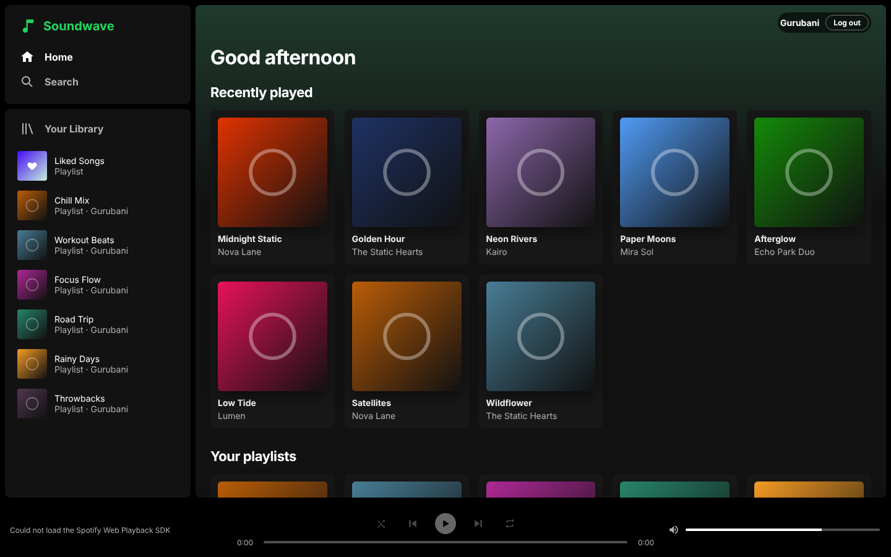

# Soundwave

A Spotify-style music web app built with React, TypeScript and Vite. It uses
Spotify's official **Web API** for browsing and the **Web Playback SDK** to
play music in the browser.



## Features

- Log in with Spotify (PKCE flow, no backend or client secret needed)
- Home: recently played, your playlists, top artists, top tracks, saved albums
- Search across songs, artists, albums and playlists
- Playlist, album, artist and Liked Songs pages
- Your Library with playlists, albums and artists
- Player bar: play/pause, next/previous, seek, volume, shuffle, repeat

## Requirements

- Node.js 18 or newer
- A Spotify account. **Playback requires Spotify Premium**; browsing works on any account.

## Setup

1. Go to the [Spotify Developer Dashboard](https://developer.spotify.com/dashboard) and create an app.
   - **Redirect URI:** `http://127.0.0.1:5173/callback`
     (Spotify no longer accepts `localhost`; use `127.0.0.1`.)
   - **APIs used:** tick *Web API* and *Web Playback SDK*.
2. In the app's **User Management** settings, add the Spotify email of every
   account that will log in. Apps in development mode only work for listed users.
3. Copy the env file and paste in your app's Client ID:

   ```sh
   cp .env.example .env
   # then edit .env: VITE_SPOTIFY_CLIENT_ID=<your client id>
   ```

4. Install and run:

   ```sh
   npm install
   npm run dev
   ```

5. Open <http://127.0.0.1:5173> and log in.

## Scripts

| Command             | What it does                      |
| ------------------- | --------------------------------- |
| `npm run dev`       | Start the dev server on port 5173 |
| `npm run build`     | Typecheck and build to `dist/`    |
| `npm run preview`   | Serve the production build        |
| `npm run typecheck` | Run the TypeScript compiler only  |

## Deploying

Build with `npm run build` and host `dist/` on any static host (Netlify,
Vercel, GitHub Pages…). Configure it to serve `index.html` for all routes, set
`VITE_SPOTIFY_REDIRECT_URI` to `https://<your-domain>/callback`, and add that
same URI to your Spotify app.

## Project layout

```
src/
  auth.ts                 PKCE login, token storage and refresh
  api.ts                  Typed Spotify Web API client
  player/PlayerProvider   Web Playback SDK wrapper and playback controls
  components/             Sidebar, player bar, track table, cards
  pages/                  Home, Search, Playlist, Album, Artist, Library, Liked Songs
```

## Notes

- Spotify has restricted some endpoints for newly created apps (for example
  artist top tracks and some editorial playlists). The app hides those sections
  when Spotify refuses them.
- Soundwave is an independent project and is not affiliated with Spotify. It
  uses no Spotify code, logos or artwork beyond what the API returns.
